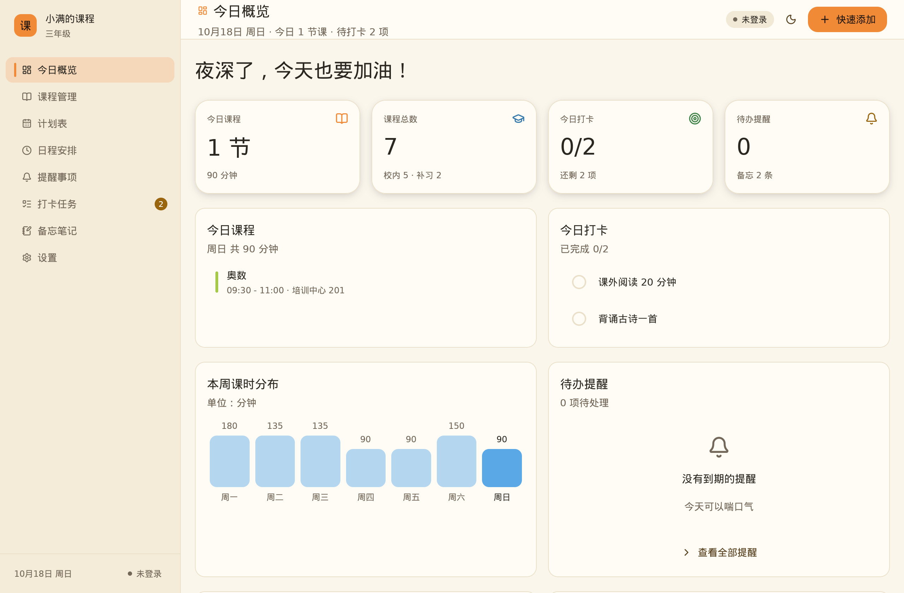
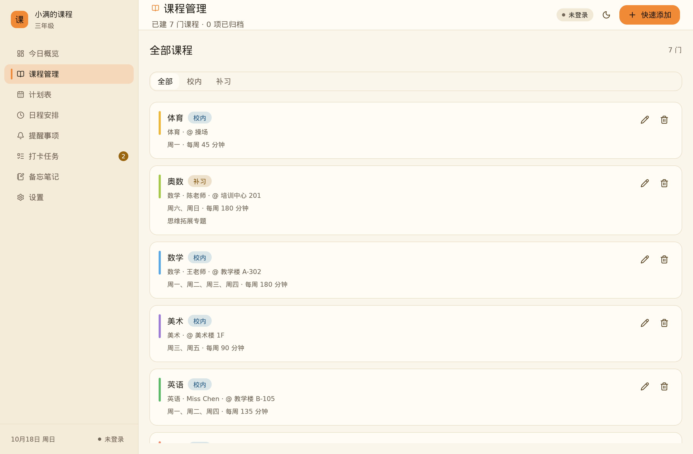
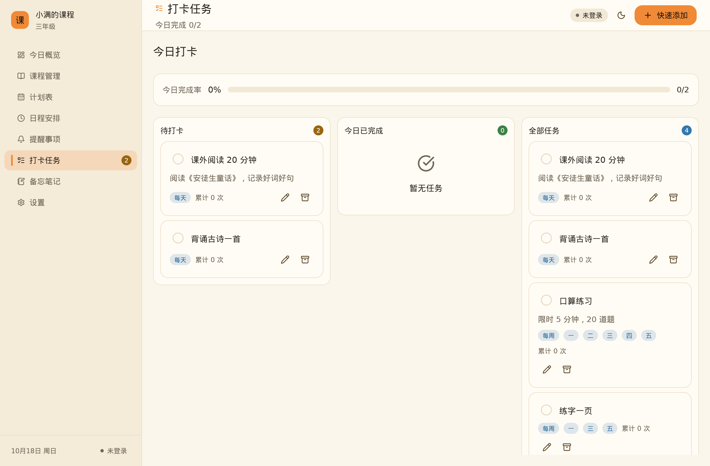

# 小学课程管理计划 · CoursePlan

一个用 Rust + [GPUI Kit](https://gpui-kit.com) 写的跨平台桌面应用，帮家长把孩子的
**学校课程**和**补习课程**管起来：录入课程 → 生成每周计划表 → 到点提醒 → 打卡记录。

界面为中文，共 **8 个页面**（今日概览 / 课程管理 / 计划表 / 日程 / 提醒 / 打卡 / 备忘 / 设置）。
应用**本地优先**：所有数据默认存在本机 JSON 文件，离线也能完整使用。
在此基础上可选启用**自托管同步**（`docker compose` 拉起一个 Rust + SQLite 服务端），
用家庭账号在多台设备之间收敛同一份数据。**任何情况下都不含遥测**。

> 本地优先 = 数据默认只在本机；只有你主动在「设置 → 同步」里填写自己的服务器地址并登录后，
> 才会有网络请求——目标是**你自己的**服务端，而不是第三方。

---

## 功能

| 模块 | 说明 |
| --- | --- |
| **今日概览** | 今日课程时间轴（含“进行中”高亮）、今日打卡、待办提醒、本周课时分布图、快捷入口 |
| **课程管理** | 学校课程 / 补习课程分类，8 种颜色标识，记录科目、老师、每周课时 |
| **计划表** | 每周 7 天网格课表，点击任意格子即可排课，右侧显示校内/补习课时汇总 |
| **日程安排** | 按日期管理一次性日程，同日显示当天课程，可标记完成 |
| **提醒事项** | 支持「仅一次 / 每天 / 每周」重复，到期弹出系统通知，区分“即将到期”和“已超时” |
| **打卡任务** | 三栏看板（待打卡 / 今日已完成 / 全部任务），记录连续天数、累计次数与完成率 |
| **备忘笔记** | 彩色卡片，支持置顶，按更新时间排序 |
| **设置** | 学生资料、学期起止、提醒开关、浅色/深色主题、数据统计与清空，以及可选的同步配置 |
| **同步** | 家庭账号（用户名 + 密码），实体级 LWW + 墓碑删除，多设备自动收敛；离线编辑后重连对齐 |

启动后可在「设置 → 载入示例数据」一键灌入一套演示内容（课程、课表、打卡与备忘），
在「设置 → 清空全部数据」中还原为空白状态。

### 截图

| 今日概览 | 课程管理 | 打卡任务 |
| --- | --- | --- |
|  |  |  |

> 截图由无头渲染测试生成（见下文「质量检查」），可直接复现。

---

## 技术栈

* **Rust 2024** + [GPUI Kit 0.7.3](https://gpui-kit.com)（GPUI 的组件库封装，版本锁定）
* 图标为 Lucide，内嵌在二进制中
* 客户端：单二进制桌面应用，数据持久化到本地 JSON 文件，原子写入（先写 `.tmp` 再 `rename`）
* 服务端（可选）：Rust + [axum](https://github.com/tokio-rs/axum) + SQLite，单容器部署
* 设计系统：见 [`docs/DESIGN.md`](docs/DESIGN.md)（“活力儿童向”，冻结版规范）
* 同步协议：见 [`docs/SYNC-PROTOCOL.md`](docs/SYNC-PROTOCOL.md)（v1.2 冻结真源）

---

## 快速开始

### 依赖

```bash
# Rust 1.92 或更高（GPUI Kit 的 Linux 依赖要求）
curl --proto '=https' --tlsv1.2 -sSf https://sh.rustup.rs | sh

# Debian / Ubuntu
sudo apt install -y build-essential clang cmake pkg-config \
    libfontconfig-dev libwayland-dev libxkbcommon-x11-dev libx11-xcb-dev \
    libssl-dev libzstd-dev libasound2-dev libvulkan1

# CachyOS / Arch
sudo pacman -S --needed base-devel cmake pkgconf fontconfig wayland \
    vulkan-icd-loader libxkbcommon alsa-lib
```

### 开发运行

```bash
cargo run
```

Linux 上必须在图形会话（Wayland 或 X11）里运行，并且需要可用的 Vulkan 驱动；
只有 Vulkan loader 而没有驱动是渲染不出来的。

### 质量检查

```bash
cargo fmt --check
cargo clippy --all-targets -- -D warnings
cargo build --release --locked

# 无头渲染 + 截图（默认跳过；需 GPU/Vulkan 环境）。产物：target/visual/*.png
COURSEPLAN_VISUAL=1 cargo test --test render
```

---

## 同步服务端（可选）

需要一台可长期运行的 Linux 主机（VPS / NAS / 家用服务器均可），
安装 Docker Engine ≥ 24 与 Docker Compose v2。完整指南见
[`docs/DEPLOY.md`](docs/DEPLOY.md)（含「部署自检」清单），这里是最短路径：
> 若当前用户不在 `docker` 组，请给下面的命令加 `sudo`，或先执行 `sudo usermod -aG docker $USER` 并重新登录。

```bash
# 1) 准备环境变量：复制模板，填入随机 JWT_SECRET（必填，缺失时服务端启动失败）
cp .env.example .env
openssl rand -hex 32        # 把输出填进 .env 的 JWT_SECRET=

# 2) 构建并启动（默认明文 HTTP，监听 :8080）
docker compose up -d --build
curl -fsS http://127.0.0.1:8080/api/health   # {"status":"ok",...}

# 3) 启用 HTTPS（强推荐）—— 叠加 Caddy 自动申请证书
#    先在 .env 里填 COURSEPLAN_DOMAIN（域名需已解析到本机、放通 80/443），
#    并把 COURSEPLAN_BIND 改为 127.0.0.1，避免明文 8080 端口仍对外可达。
cp deploy/Caddyfile.example deploy/Caddyfile
docker compose -f docker-compose.yml -f docker-compose.tls.yml up -d --build
```

启动后，在客户端打开「**设置 → 同步**」，填写**服务器地址**（如 `http://<主机>:8080`
或 `https://<域名>`）、用户名与密码，点「注册」创建家庭账号或点「登录」接入已有账号，
即可多设备收敛。HTTPS、备份、升级与排障等详见 [`docs/DEPLOY.md`](docs/DEPLOY.md)。

---

## 数据存放位置

运行时会写入数据目录下的三个文件：

| 文件 | 内容 | 是否同步 |
| --- | --- | --- |
| `data.json` | 课程、课表、日程、提醒、打卡、备忘等业务数据 | ✅ 同步到你的服务端 |
| `sync.json` | 服务器地址、账号凭据 / Token、设备标识、同步游标（权限 `0600`） | ❌ 本机凭据 |
| `runtime_state.json` | 设备本地运行态（如提醒「已通知」记账） | ❌ 仅本机 |

各平台默认数据目录：

| 平台 | 路径 |
| --- | --- |
| Linux | `~/.local/share/courseplan/course-plan/` |
| macOS | `~/Library/Application Support/com.courseplan.CoursePlan/course-plan/` |
| Windows | `%APPDATA%\courseplan\CoursePlan\data\course-plan\` |

> 路径由 `directories` crate 的 `ProjectDirs::from("com", "courseplan", "CoursePlan")` 推导：
> Linux 取 `$XDG_DATA_HOME`（默认 `~/.local/share`）+ 小写应用名 `courseplan`；macOS 取
> `~/Library/Application Support/<bundle id>`；Windows 取漫游 AppData + `courseplan\CoursePlan\data`。
> 应用再统一追加 `course-plan` 子目录（`store.rs::data_dir()`），即上表末段。

> **覆盖数据目录**：设置非空的 `COURSEPLAN_DATA_DIR` 环境变量即可直接指定数据目录
> （便于开发、测试与数据隔离），例如 `COURSEPLAN_DATA_DIR=/tmp/cp cargo run`。

卸载应用不会删除数据文件，需要时可在设置页手动清空。

---

## 打包发布

完整的多平台编译说明见 [`packaging/CROSS-COMPILE.md`](packaging/CROSS-COMPILE.md)。
一句话版本：**每个平台都在各自的系统上构建**（GPUI 的图形后端不同）。
服务端打包/部署见 [`docs/DEPLOY.md`](docs/DEPLOY.md)。

### Linux（CachyOS / Debian / Ubuntu / Arch）

```bash
cargo build --release --locked

./packaging/linux/build-deb.sh         # dist/course-plan_<version>_amd64.deb + 便携 tar.gz
./packaging/linux/build-appimage.sh    # dist/course-plan-<version>-x86_64.AppImage
```

安装测试：

```bash
sudo apt install ./dist/course-plan_0.1.0_amd64.deb
```

`build-deb.sh` 会用 `dpkg-shlibdeps` 从**实际构建出的二进制**推导运行时依赖，
再补上 Vulkan 与图形栈。`.deb` 会注册桌面菜单项和图标，`sudo apt remove course-plan`
可以干净卸载。

### Windows 11

```powershell
cargo build --release --locked
pwsh -File packaging\windows\build-windows.ps1
```

需要 **MSVC 工具链**（不是 GNU）、Visual Studio 2022 Build Tools 的
“使用 C++ 的桌面开发”工作负载，以及 Inno Setup 6。产物：

* `dist\CoursePlan-<version>-windows-x64.zip` — 便携版，解压即用
* `dist\CoursePlan-Setup-<version>.exe` — 安装包，带开始菜单/桌面快捷方式与卸载项

### macOS 11+（Intel 与 Apple Silicon）

```bash
ARCH=aarch64 ./packaging/macos/build-macos.sh   # Apple silicon
ARCH=x86_64  ./packaging/macos/build-macos.sh   # Intel
```

产物：`.app` 包、`.dmg`、以及供公证用的 `.app.tar.gz`。
设置 `SIGN_IDENTITY` 与 `NOTARY_PROFILE` 环境变量即可完成签名与公证。

### CI

`.github/workflows/release.yml` 用 GitHub Actions 的 matrix 同时构建
Linux / Windows / macOS(arm64 + x86_64)，推 tag 即发布；
`.github/workflows/server.yml` 负责服务端镜像的构建与检查。

---

## 项目结构

Cargo **workspace**：根包是客户端桌面应用，另有两个成员 crate。
（`cargo run` 默认运行客户端；服务端二进制为 `course-plan-server`。）

```
src/                          # 客户端（根包 course-plan）
├── main.rs                   # 入口：初始化、窗口、身份、同步 worker 装配
├── app.rs                    # 应用外壳：侧边栏、顶栏、导航、提醒循环、同步编排
├── model.rs                  # 数据模型：课程/课表/日程/提醒/打卡/备忘
├── store.rs                  # 持久化：data.json / sync.json / runtime_state.json
├── theme.rs                  # 主题（浅/深色）与设计令牌落地
├── sync/                     # 同步引擎（核心时序 + HTTP worker）与测试
├── ui/                       # 设计系统组件、令牌、配色板、表单/下拉等
└── views/                    # 8 个页面（dashboard / courses / schedule / events /
                              #   reminders / checkins / memos / settings）

crates/
├── sync-proto/               # 客户端/服务端共享的同步协议类型
└── server/                   # 同步服务端（axum + SQLite）+ Dockerfile + migrations

tests/                        # 集成测试：收敛（真实服务端）、无头渲染、图标、视图
packaging/                    # 各平台打包脚本、图标、desktop entry、跨平台指南
docs/                         # 设计系统 / 同步协议 / 部署指南 / 实施计划
```

### 架构约定

* 每个页面是一个普通函数 `render(&mut App, &mut Context<App>) -> impl IntoElement`；
  需要交互的局部状态（输入框、下拉框）各自是一个 `Entity<...>` 视图。
* 编辑器通过 `Rc<dyn Fn(Draft, &mut Window, &mut gpui::App)>` 回调把结果交回 `App`，
  `App` 负责校验、写库和提示。
* 所有本地写操作都走 `App::commit`，它负责保存 JSON 并弹通知，失败不会丢数据。
* 同步只由 UI 线程读写落盘文件，`sync/` worker 只负责 HTTP 请求与轮次时序
  （协议细节见 [`docs/SYNC-PROTOCOL.md`](docs/SYNC-PROTOCOL.md)）。

---

## 已知限制

* 模态对话框只压暗内容区（侧栏与顶栏在打开时仍可交互）；整窗压暗需要 shell 级
  dialog host，已作为后续项记录在 `docs/DESIGN.md` §7。
* 无头截图测试需要可用的 Vulkan/GL 适配器（无 GPU 环境会自动跳过）；
  Linux 上可用 lavapipe 软件渲染，见「质量检查」。
* 提醒循环每 30 秒轮询一次，精度到分钟级；系统通知依赖平台的通知服务，
  Linux 上需要 `libnotify`/桌面通知守护进程。
* 课程表按「每周重复」建模，暂不支持单周调课与节假日例外。
* 同步服务端不含限流/风控、账号找回与端到端加密（见 `docs/PLAN.md` 非目标），
  **请勿把明文 HTTP 端口直接暴露到不受信任网络**——生产部署务必启用 HTTPS。

## 许可

Apache-2.0
